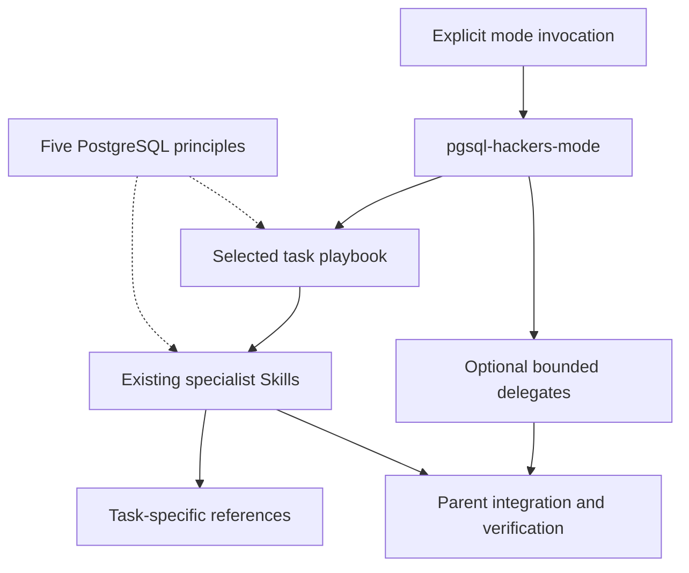

# Architecture

Accepted 2026-10-06; Copilot added 2026-10-09. Based on [research](research.md).

## Package

One Git-installable APM package contains one coordinator mode, seven specialist
Skills, five principle Skills and one shared contributor instruction. The mode
loads eight playbooks. Installation, versioning and testing remain together.

| Path | Contents |
| --- | --- |
| `apm.yml`, `apm.lock.yaml` | Package metadata and generated dependency lock |
| `.apm/instructions/` | Shared rules and a copy of the license for packing |
| `.apm/skills/` | Workflows and local references |
| `.agents/skills/release-pgsql-hackers-toolkit/` | Repository-only release maintenance Skill |
| `docs/`, `examples/` | Sources, validation and usage |
| `tests/`, `evals/`, `.github/workflows/` | Package checks and behavioral evaluation |

`.apm/` is the authored source for distributed agent files. APM deploys files and
rewrites links; generated provider trees, root instructions, caches and bundles
are not committed. The sole exception under `.agents/skills/` is the authored
[release maintenance Skill](../.agents/skills/release-pgsql-hackers-toolkit/SKILL.md),
tracked for local discovery after cloning this repository. It is outside manifest
`includes`, excluded from archives and consumer deployment, and preserved by APM
install, compile and prune. Tests enforce these boundaries. Release preparation
creates a PR; explicit publication after human merge uses the existing tag CI.
The copied license must match root `LICENSE`; APM's pack allowlist excludes the root file.

| Target | Installation output |
| --- | --- |
| Codex | `.agents/skills/`; compile shared instructions into `AGENTS.md` |
| Claude Code | `.claude/skills/` and native `.claude/rules/` |
| GitHub Copilot | `.agents/skills/` and native `.github/instructions/`; no compile needed |
| `agent-skills` | `.agents/skills/`; the host must load linked shared instructions |

Consumers explicitly select targets from those supported by the package.
Copilot uses the existing APM target without an adapter or dependency. Copilot-only
consumers omit compilation: `--single-agents` would emit a redundant `AGENTS.md`.
Combined Codex/Copilot consumers still compile Codex context, which Copilot may
also read; separate workspaces avoid overlap. Ignore generated Copilot paths
individually, preserving `.github/workflows/` as maintained source.
Keep `apm_modules/` for deployed links. Native Git/local-source installation is
supported; bundle installation has [constraints](validation.md#apm-0330-constraints).

## Workflow layers

The [mode](../.apm/skills/pgsql-hackers-mode/SKILL.md) selects procedures,
tracks progress, delegates when useful and verifies the requested result. Its
`playbooks/` own task sequencing and completion criteria. The existing specialists
own the detailed work and remain directly callable, without routing back to the mode.
Design-only and validation-only requests use their specialists directly.

Principles describe evidence-first investigation, subsystem invariants, minimal
changes, behavior verification and comparable measurement. They are supporting
reads loaded at the relevant decision, not independent workflow selections.
The always-applied contract retains checkout identity, evidence boundaries,
protection of existing work and authorization for external writes.

Only the new mode sets `disable-model-invocation: true` and carries
`agents/openai.yaml` with `allow_implicit_invocation: false`. These implement
explicit invocation for supported Claude/Copilot and Codex hosts respectively.
A generic Agent Skills host must implement the relevant policy; document a host
that ignores it rather than claiming a portable enforcement guarantee.

[Delegation](../.apm/skills/pgsql-hackers-mode/references/delegation.md) defines
researcher, implementer and reviewer briefs without provider-specific agent
registration or model pins. Delegation depends on available tools and session
permission. Serial execution remains supported and self-review is labeled.
The parent owns the final integrated diff and validation.

APM copies nested playbooks, references and policy files with the skill and
rewrites Markdown links, including links from playbooks. Cross-skill links may
resolve into `apm_modules/`; keep that cache. No extra build/generation layer or
new artifact dependency is introduced.

## Checkout and permissions

Select the PostgreSQL checkout from the task path, then `PG_SOURCE`, then the
workspace root. Resolve relative paths from the workspace, validate the source
tree and record revision and working state. Never guess a sibling or fetch source
automatically. A separate workspace keeps generated files out of PostgreSQL diffs.

The [shared instructions](../.apm/instructions/postgresql-contributor.instructions.md)
define evidence, working-tree and submission rules. External pages, mail and
patches are evidence; agent permissions enforce access. Tests use isolated
temporary projects.

v0.1 has no external agent dependencies, custom agents, hooks, MCP/LSP servers
or model pins. APM owns package management; Python helpers only validate output.
